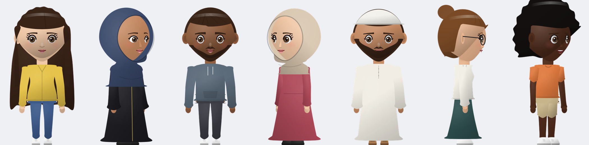
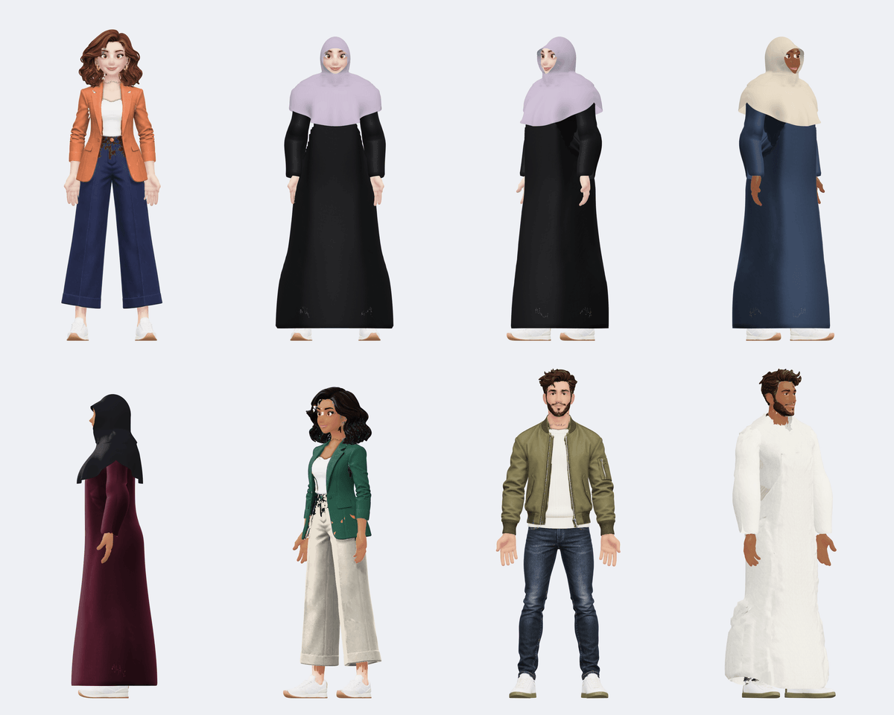
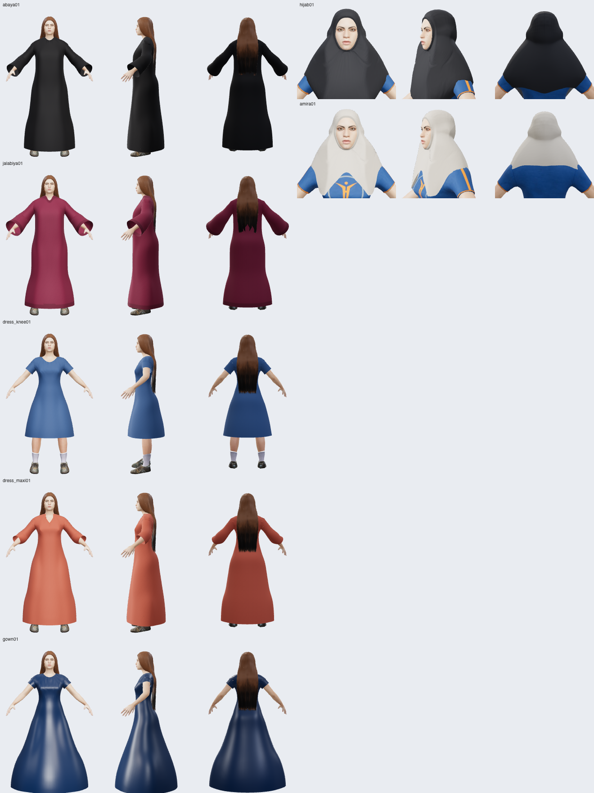

# HumanForge

An open-source avatar SDK for React and React Native, built as an open alternative to hosted
avatar builders such as MetaPerson Creator. It has three modes:

- **Cartoon 2D** (`humanforge/cartoon`): layered PNG avatars for every device, including low-end
  Androids. No GL. Five angles, sliders, modest wear. [Jump to it](#cartoon-2d-avatar).
- **Realistic human** (`humanforge/human`): MakeHuman-based 3D, described below.
- **Stylized low-poly** (`humanforge/core`): procedural 3D.

| | **Realistic human** (`humanforge/human`) | **Stylized low-poly** (`humanforge/core`) |
| --- | --- | --- |
| Look | Photoreal skin, eyes, hair cards, clothes | Flat-colored, procedural |
| Base | MakeHuman / MPFB2 human (CC0), 26.7k-triangle body | three.js primitives, 7–11k triangles |
| Customization | 11 macro + 57 detail morph sliders, 20 skins, 9 eye colors, 12 brows, 4 lashes, 19 hairstyles, 28 outfits, 6 shoes | 30+ options |
| Rig | 52-bone **Mixamo** skeleton with skin weights (clothes and hair follow) | none |
| Face animation | 34 FACS blendshapes with **ARKit names** (`jawOpen`, `mouthSmile`, `eyeBlinkLeft`, …) | none |
| Download | ~1.4 MB one-time core + ~0.3–0.8 MB per look (gzipped, cached on device) | 0 (code only) |
| Export | Compressed GLB (~3 MB with textures, sparse blendshapes) | GLB ~160 KB |

## Cartoon 2D avatar

A chibi-style, full-body cartoon avatar made of layered PNGs (the art is generated in code, so it
is original and CC0). It is built for **every phone, high and low end**: no GL, no WebView, only
`<Image>` and the native animation driver.



```bash
npx expo install expo-file-system react-native-view-shot   # view-shot only for snapshots
```

```tsx
import { CartoonEditor, CartoonView, useCartoonPackage, preloadCartoon } from 'humanforge/cartoon';

const ASSETS = 'https://cdn.jsdelivr.net/gh/abdulrehman043/humanforge@v0.6.0/assets/cartoon';

// editor screen
const { pkg, ready } = useCartoonPackage(ASSETS, { config: saved, width: 260 });
if (!pkg || !ready) return <Loading />;
<CartoonEditor
  pkg={pkg}
  defaultValue={saved}
  options={{ gender: 'female', modest: true }}      // abaya, jalabiya, maxi dress, hijab, al-amira
  onSave={(config, pngUri) => api.saveAvatar(config)}
/>

// anywhere else (profile, chat, lists)
<CartoonView pkg={pkg} config={saved} width={96} framing="bust" swipe={false} />
```

**What users can change:** 12 skin tones; 5 eye styles + 8 eye colours; 5 brow styles; 4 noses;
5 mouths + lip colour; 14 hairstyles (14 hair colours); beards (5); glasses (2); headwear (hijab,
al-amira, kufi, beanie); 8 tops, 5 bottoms, 4 one-piece outfits (abaya, jalabiya, maxi dress,
dress), 4 shoes, all recolourable; 10 shape sliders (head size, face width, eye size and height,
brow height, nose size, mouth width and height, build, height); female/male body.

**Same pattern as `HumanEditor`:** the config is plain JSON (`CartoonConfig`); `createCartoonEditor(pkg, options)`
gives the sections and controls as data; `getCartoonCatalog(pkg)` gives every option with its
preview tile or colour swatch for custom UIs. Options: `gender`, `modest`, `sections`,
`exclude` / `include`, `items`, `colors`, `optional`, `sliderRange`, `defaults`, `locked`, `labels`.

### Stylized pack (Bitmoji-like, `cartoon-g3d`)

A second art set for the same `CartoonView`: soft 3D-cartoon people (woman and man) with a fitted
hijab, abaya, jalabiya and casual outfits, at 3 angles (5 views). Hair, skin, eyes, brows, lips,
clothes and the hijab all recolour; the face and body sliders work as with the chibi art.



```tsx
const ASSETS = 'https://cdn.jsdelivr.net/gh/abdulrehman043/humanforge@cartoon-g3d-v0.7.0/assets/cartoon-g3d';
const { pkg, ready } = useCartoonPackage(ASSETS, { config: saved, width: 260 });
// modest: createCartoonEditor(pkg, { gender: 'female', modest: true }) -> abaya + hijab by default
```

It is ~5 MB (186 layers at 1x/2x) and lives on its own git tag, like the mobile texture pack.
Rebuild it with `npm run g3d:fetch && npm run build:cartoon-g3d` (needs Chrome; ~7 min): the
characters are rendered in three.js with our CC0 modest wear fitted on, then split into tint and
shading layers by part (`tools/cartoon-g3d/`). Per-build registration (`buildPivots`) keeps the
sliders anchored on the taller male head.

### How it stays smooth

| Requirement | How |
| --- | --- |
| No GL | Every part is a small trimmed PNG in an `<Image>`; colours use native `tintColor` (white masks + a separate shading layer). |
| First frame after warm ≤ 300 ms | `useCartoonPackage` / `preloadCartoon` put all layers of the look on disk first; only the visible angle mounts at first (27–36 small images), the others mount right after the first frame; Android `fadeDuration` is 0. |
| Slider drag without JS stalls | Slider values are `Animated.Value`s handed to the **native driver**; each part's transform is built from them, so a drag only sends numbers to the native side: no React render and no layout per move. The config updates once, on release. |
| Hair/outfit swap keeps the old look | The new layer set mounts invisibly and replaces the old one only when every image has loaded (double buffering); nothing blanks. Colour changes reuse the mounted images. |
| Angle swipe at 60 fps | 5 angles (front, ¾ and profile each side; left ones are mirrored right ones, so they share bitmaps). A paging `ScrollView` drives each angle's opacity through `Animated.event` on the native driver: zero JS per frame. |
| Low memory / fill rate | Layers come in 1x and 2x; `cartoonDensity()` picks 1x unless the avatar is drawn > 760 px wide (GPU fill rate is what limits swiping on weak phones). A look is ~300 KB (1x) / ~650 KB (2x) to download and ~8 MB / ~32 MB decoded for all angles. Hidden angles are moved out of the clip area natively, so they cost no drawing. |

### Acceptance on your devices

`<CartoonBench pkg={pkg} />` is a ready-made test screen: it measures first frame after warm,
JS frame times while sliders move every frame, swap commit time and the angle swipe, and shows
PASS/FAIL (and can share the JSON). The UI thread's frame rate can't be measured from JS: watch
the Perf Monitor (dev menu) on iOS and run `scripts/android-jank.sh <your.package>` on Android
while swiping and dragging (target: < 5% janky frames).

**Status (0.6.0):**
- Verified in a browser through react-native-web: layout, tinting, sliders without React
  re-renders, swaps that keep the old look on a simulated slow network, and the angle swipe.
- Ran natively in Expo Go on an Android 14 emulator (host GPU, debug JS):
  - first frame after warm: 66–101 ms
  - slider drag: 0.06–0.13 ms of JS per update, JS p95 19–24 ms
  - hair/outfit swap: 93–195 ms, with the old look held
- Emulator frame times are dominated by its GL translation overhead. Even a plain list scroll
  there is 6–12% janky; the angle swipe at 1x was 12–15%.
- **Not yet measured on real phones.** Accept it only after `CartoonBench` and
  `android-jank.sh` pass on your weak Android and a mid iPhone.

To rebuild or extend the art: `npm run build:cartoon` (sources in `tools/cartoon/`).

### Using commissioned art

The built-in art is generated chibi art. To ship an illustrator's art kit instead, import it into the
same package format; `CartoonView`, `CartoonEditor` and the cache don't change.

**What the artist delivers**

- Full-canvas **800×1280** PNGs with a transparent background, in `front/`, `three/` (¾, facing
  right) and `side/` (profile, facing right). The app mirrors them for the left-facing views.
- One file per sub-layer: `<part key>.<n>.<kind>.png`. Sub-layers paint by `n`; within one `n`
  the order is `under`, `tint`, `detail`.
  - `tint`: a pure white mask. The app colours it (skin, hair, fabric…).
  - `detail`: shading, lines and highlights, drawn as-is over the tint.
  - `under`: drawn as-is beneath the tint, e.g. an ink outline.
- Part keys:

  | Part | Key |
  | --- | --- |
  | Body (per build, three depth bands) | `body.<female\|male>.<back\|mid\|front>` |
  | Head (per build) | `head.<female\|male>` |
  | Ears | `ears.<back\|front>` |
  | Face parts | `eyes.<style>`, `brows.<style>`, `nose.<style>`, `mouth.<style>`, `facial_hair.<style>`, `glasses.<style>` |
  | Hair | `hair.<style>.<back\|front>` |
  | Headwear | `headwear.<style>.<female\|male>` |
  | Clothes | `<top\|bottom\|outfit\|shoes>.<style>.<female\|male>.<back\|mid\|front>` |

  Styles are lowercase `a-z0-9_`. `glasses` has no colour slot, so it uses `detail` (and `under`) only.
- A **registration sheet** with these points per angle: neck base, head centre, both eye centres,
  nose tip and mouth centre.

**What you add next to the kit**

`pivots.json`: copy the points from the registration sheet, in art pixels.

```json
{
  "front": { "neck": [400, 492], "head": [400, 308], "eyes": [[360, 329], [440, 329]], "nose": [400, 377], "mouth": [400, 418] },
  "three": { "neck": [412, 492], "head": [420, 308], "eyes": [[392, 329], [468, 330]], "nose": [478, 377], "mouth": [452, 418] },
  "side":  { "neck": [430, 492], "head": [440, 308], "eyes": [520, 329], "nose": [568, 377], "mouth": [540, 418] }
}
```

The sliders scale and move parts about these points. Head size grows from the neck, face width
from the head centre, eye size from the eyes, and so on. With the chibi art these points were
hard-coded; adult proportions need the real ones. Also:
- `feet` is optional. The importer uses the lowest body or shoe pixel.
- `brows` is optional and defaults to a little above the eyes.
- Add `"units": "canvas"` to give the points in 400×640 units instead of pixels.
- Add `"frames": { "head": {x,y,w,h}, "bust": {…} }` to override the `framing="head"|"bust"`
  crops. By default they come from the head and neck points.

`items.json`: item metadata you maintain. Every key is optional.

```json
{
  "hair":        { "long_wavy": { "fit": "female", "coversEars": true } },
  "facial_hair": { "beard": { "fit": "male" } },
  "headwear":    { "hijab": { "fit": "female", "hidesHair": true, "modest": true, "color": "#3b4a6b" } },
  "outfit":      { "abaya": { "modest": true, "color": "#1f1f24" } },
  "top":         { "tshirt": { "color": "#3f7fd6" } }
}
```

- `fit` defaults to the builds the art was drawn for (both builds = `unisex`); beards default to `male`.
- `modest` decides what `options.modest` offers.
- `color` is the default colour when the item is picked. Headwear and clothes without one get a warning.
- Items are listed in `items.json` order, then the rest alphabetically.

**Import**

```bash
npm run import:cartoon -- path/to/kit --check
```

```bash
npm run import:cartoon -- path/to/kit --out assets/cartoon
```

`--check` only validates. Without it, the importer validates everything first and writes nothing
if anything is wrong. It checks:
- the canvas size and the transparent background
- that `tint` layers are pure white
- file names and part keys
- that every item has art at every angle for each build it fits, and that each build has a head and a body
- the pivots and `items.json` values

Then it:
- trims each layer and writes 1x (400×640 units) and 2x (the art's own resolution) PNGs
- writes `manifest.json`, with `facial_hair` stored as the `facialHair` slot
- renders a preview tile per item and the editor's section icons from the imported layers
- clears only `1x/`, `2x/`, `previews/`, `icons/` and `manifest.json` in `--out`

`--pivots` and `--items` point to files outside the kit folder.

Runtime support for this kit format:
- `head.<build>` keys
- `under` layers
- `facial_hair.*` keys
- neck, head and feet pivots and framings read from the manifest

Packages without them (the built-in art) still use the old `PIVOTS` constants.

**Try it without real art:** `npx tsx tools/cartoon/make-test-kit.mts /tmp/kit` writes a fake kit
made from the built-in art. It is recoloured, moved up, renamed to the artist's scheme, and has a
per-build head, an `under` outline and `facial_hair`. It comes with `pivots.json` and `items.json`.
Import it with `npm run import:cartoon -- /tmp/kit --out /tmp/pkg`.

**See it in the editor locally:**
1. `npm run demo:kit` makes the fake kit in `.local/test-kit` and imports it to `assets/cartoon-kit` (both gitignored).
2. `npm run demo:cartoon` starts the react-native-web harness.
3. Open `/cartoon.html?pkg=cartoon-kit` (add `&gender=male` or `&modest=1`).

For real art, import it with `--out assets/cartoon-kit` and open the same URL.
`scripts/cartoon-import-test.mts` (part of `npm test`) does the same with broken kits.

## Realistic human

### 1. Build the asset package (once)

The human is built from CC0 data: the MakeHuman base mesh, targets, skins, hair and clothes, plus
MPFB2's Mixamo rig and expression units.

```bash
git clone --depth 1 --filter=blob:none --sparse https://github.com/makehumancommunity/mpfb2.git
cd mpfb2 && git sparse-checkout set src/mpfb/data && cd ..
curl -LO https://files2.makehumancommunity.org/asset_packs/makehuman_system_assets/makehuman_system_assets_cc0.zip
unzip makehuman_system_assets_cc0.zip -d mh_assets
# CC0 community packs: extra hairstyles, dresses and suits (the items listed in tools/extra-assets.json)
for p in hair01 dress01 suits01; do
  curl -LO https://files2.makehumancommunity.org/asset_packs/$p/${p}_cc0.zip && unzip -q ${p}_cc0.zip -d mh_$p
done
npm run build:human -- mpfb2/src/mpfb/data mh_assets \
  --extra mh_hair01 --extra mh_dress01 --extra mh_suits01  # -> assets/human (~26 MB, all options)
npm run build:garments                                     # + modest wear and dresses (below)
npm run build:previews                                     # thumbnails + swatches for every option (needs Chrome)
npm run build:mobile -- --skin-2k                          # JPEG/PNG texture pack for Expo (no WebP in expo-gl)
```

Leave out the `--extra` packs for the system set only (~14 MB). Every item loads on demand, so
the size is what you host, not what each user downloads. To add other community items, put
their ids in `tools/extra-assets.json` (with author, license and source) and their labels in
`src/human/catalog.ts`. `demo/wardrobe.html` renders a contact sheet of hairstyles or outfits
for comparing them.


`build:garments` (`tools/build-garments.mts`) adds garments the MakeHuman packs don't have, generated
in code from the human package itself (no third-party assets): **hijab**, **al-amira**, **abaya**,
**jalabiya**, a **day dress**, a **maxi dress** and an **evening gown**. They are regular proxies, so
they follow every body and face slider; they are tintable (`garmentColors`, palette in
`GARMENT_COLORS`), and headwear hides the hair while worn. Run it again after `build:human`.
`demo/garments.html` renders a contact sheet (`?variants=1` adds extreme body shapes).



Host `assets/human/` on any static host or CDN (S3, Cloudflare R2, GitHub Pages…). No server
compression is needed: binaries are pre-gzipped and decoded in JS by `fflate`.

### 2. React Native (Expo)

```bash
npx expo install expo-gl expo-file-system three fflate
```

```tsx
import { HumanView, useHumanPackage } from 'humanforge';

const ASSETS = 'https://cdn.jsdelivr.net/gh/abdulrehman043/humanforge@v0.5.0/assets/human';

function Avatar({ config }) {
  // ready = the first textured frame can be painted (manifest, body, and this look's
  // hair/clothes/skin/eyes are on disk), not just "manifest loaded"
  const { pkg, ready, progress } = useHumanPackage(ASSETS, { config, textureSize: '1k' });
  if (!pkg || !ready) return <Loading progress={progress} />;
  return (
    <HumanView
      pkg={pkg}
      config={config}
      framing="face"                 // or "body"
      textureSize="1k"               // see the table below
      expressions={{ mouthSmile: 0.6 }}
      onReady={() => SplashScreen.hideAsync()}   // fires once, after the first textured frame
      style={{ width: 240, height: 240, borderRadius: 120 }}
    />
  );
}
```

A ref gives you `avatar` (bones, `setExpression`), `render()` and `snapshot()` (PNG file URI).

#### Textures on Expo: the mobile pack

expo-gl uploads images through stb_image, which **can't decode WebP**: a WebP texture leaves the
mesh black with only the lights showing. The asset package therefore ships a **mobile texture
pack** with the same textures as baseline JPEG (opaque) and paletted PNG (hair, lashes, lace),
in three tiers. `useHumanPackage`, `preloadHumanPackage` and `expoLoadOptions` select it
automatically (`textureFormat: 'mobile'`); the web keeps using WebP. Nothing is converted on the
device, and nothing large goes into your app or the npm package: files download from the CDN
on demand and stay in the app's cache directory (offline on later launches).

| `textureSize` | Max edge | Use for | First-look download* |
| --- | --- | --- | --- |
| `'512'` | 512 px | lists, chat bubbles, avatars under ~120 pt | ~0.8 MB |
| `'1k'` (default) | 1024 px | profile, bust/face framing; at phone sizes this matches web 2k | ~1.2 MB |
| `'2k'` | 2048 px (skins) | full-screen face close-ups, tablets | ~1.3 MB |

\* meshes + textures of a default look (hair, outfit, shoes, skin, eyes, brows, lashes); the
shared body and shape data add ~1.45 MB once. Brows, lashes and eye textures are small at every
tier; textures are never upscaled.

On the jsDelivr setup the pack lives on its own git tag (`mobile-v0.5.0`), because jsDelivr serves
GitHub versions only up to 50 MB; `manifest.mobileTextures.baseUrl` points there, so you only pass
the main URL. Self-hosting: run `npm run build:mobile` and upload `assets/human/mobile/` next to
`manifest.json` (or pass `mobileBaseUrl`).

#### Preload during the splash screen

```tsx
import { preloadHumanPackage } from 'humanforge';

// resolves when the files are on disk, so the first <HumanView> paints textured at once
await preloadHumanPackage(ASSETS, { config: savedAvatar, textureSize: '1k', onProgress: (done, total) => {} });
```

It shares its cache with `useHumanPackage` (same URL = same package, no second download).

#### Performance knobs

| `HumanView` prop | Default | Notes |
| --- | --- | --- |
| `textureSize` | `'1k'` | tiers above |
| `pixelRatio` | device (max 3) | `2` on 3x phones renders ~55% fewer pixels and still looks sharp |
| `antialias` | `true` | MSAA (expo-gl `msaaSamples` on iOS) |
| `maxTextureAnisotropy` | `2` | `1` turns it off |
| `normalMaps` | `true` | `false` skips clothing normal maps (lighter, slightly flatter fabric) |

Slider, color and expression changes reuse the textures already on the GPU: only a new item
(hair, outfit, skin tone) or a new tier loads files. `onReady` fires once per avatar, after the
first frame with all textures; it does not fire again on later edits.

Recommended: editor screen `textureSize="1k"` (or `'2k'` on tablets), lists and thumbnails
`'512'` with `pixelRatio={2}`. For option pickers, use the static preview images and swatches
(`getHumanCatalog`, below) rather than live 3D views: they are small WebP files shown with
`<Image>`, which uses the platform decoder (WebP is fine there).

### 3. React / web

```ts
import { HumanAvatar, loadHumanPackage } from 'humanforge/human';
import { exportHumanGLB } from 'humanforge/human/export';   // optional, web only

const pkg = await loadHumanPackage('/human');
const avatar = new HumanAvatar(pkg);
scene.add(avatar.group);
await avatar.setConfig({ gender: 0.9, muscle: 0.7, hair: 'short02', eyes: 'green' });
avatar.setExpression('jawOpen', 0.4);
avatar.bones.find((b) => b.name.endsWith('LeftArm'))!.rotateZ(-0.8);
const glb = await exportHumanGLB(avatar);   // Mixamo-rigged, ARKit blendshapes
```

`demo/human.html` is a complete web editor (`npm run demo`, then open `/human.html`).

### Avatar editor: one config, web and React Native

`<HumanEditor>` is a drop-in customization screen with live 3D preview, section tabs (face,
skin, eyes, brows, nose, mouth, ears, hair, headwear, body, outfit, shoes, hat), randomize and save. The
same `options` object decides what your users may change on both platforms:

```tsx
// React web
import { HumanEditor, useHumanPackage } from 'humanforge/web';
// React Native (Expo)
import { HumanEditor, useHumanPackage } from 'humanforge/native';

const ASSETS = 'https://cdn.jsdelivr.net/gh/abdulrehman043/humanforge@v0.5.0/assets/human';
const { pkg } = useHumanPackage(ASSETS);

<HumanEditor
  pkg={pkg}
  defaultValue={savedAvatar}                 // the JSON you stored last time (optional)
  options={{
    gender: 'female',                        // 'female' | 'male' | 'any'
    sections: ['face', 'eyes', 'nose', 'mouth', 'hair', 'outfit'],
    exclude: ['ears', 'nose.noseHump', 'body.cupSize'],
    items: { hair: ['long01', 'ponytail01', 'bob02'] },
    colors: { hair: ['#1a1412', '#3d2618', '#6b4428', '#e6c88a'] },
    detailRange: 0.7,                        // keep faces natural
    locked: { eyes: 'brownlight' },          // never editable
  }}
  onSave={(config, snapshot) => api.saveAvatar(config)}
/>
```

| Option | What it does |
| --- | --- |
| `gender` | `'female'` or `'male'` locks the gender, hides the gender slider, and filters hair, clothes and skins to ones that suit it. `'any'` shows everything. |
| `sections` | Which tabs to show, in order. |
| `exclude` / `include` | Hide (or whitelist) whole sections or single controls: `'ears'`, `'hair.color'`, `'nose.noseWidth'`, `'body.weight'`… |
| `items` | Allowed ids per slot: `hair`, `headwear`, `outfit`, `shoes`, `hat`, `skin`, `eyes`, `eyebrows`, `eyelashes`. |
| `colors` | Palettes for `hair`, `eyebrows` and `garments` (outfit/headwear fabric). |
| `skinTones` | Skin tone ids to offer, in order (default: all of `HUMAN_SKIN_TONES`, light to deep). |
| `featureSliders` | Also show the face-feature mix sliders (african / asian / caucasian morphs). Off by default. |
| `optional` | Slots that offer "None" (`hair`, `hat`, `headwear`, `eyebrows`, `shoes`). |
| `detailRange` | Caps the face/body detail sliders (0..1). |
| `defaults` / `locked` | Starting values / values that are always enforced. |
| `labels` | Rename any section, control or item (for translation). |

The config is plain JSON; store it as-is. On load, `editor.normalize(saved)` (done for you by
`<HumanEditor>`) repairs anything the current options don't allow. For example, a male outfit in
a female-only app gets swapped for a women's one. To display the avatar elsewhere, use
`<HumanCanvas>` (web) or `<HumanView>` (React Native) with the saved config. To build your own UI,
`createHumanEditor(pkg, options)` returns the same sections and controls as data.

#### Previews and swatches (no text options)

Every pickable option ships with a picture or a color, so your UI never has to print item names:

| Attribute (`key`) | Shown as | Source |
| --- | --- | --- |
| `skin.tone` | round swatch | 11 tones, light to deep; the texture's age/gender variant follows the avatar automatically |
| `eyes.color` | round iris image + swatch | `previews/eyes-<id>.webp` |
| `eyes.lashes`, `brows.style` | thumbnail | close-up renders |
| `hair.style`, `headwear.style`, `hat.style` | thumbnail | head renders (3/4 view) |
| `outfit.style` | thumbnail | full-body renders |
| `shoes.style` | thumbnail | shoe close-ups |
| `hair.color`, `brows.color`, `outfit.color`, `headwear.color` | round swatch | palettes |

Thumbnails are 192 px transparent WebP files in `assets/human/previews/`, so they sit on any
background. `None` options have `id: null` and no preview (the built-in editors draw a ⌀ icon).

```tsx
import { getHumanCatalog } from 'humanforge/human';

const attrs = getHumanCatalog(pkg, { gender: 'female' });   // same options as <HumanEditor>
const hair = attrs.find((a) => a.key === 'hair.style')!;
hair.options;        // [{ id: 'long01', label: 'Long straight', preview: 'https://…/previews/hair-long01.webp' }, …]
hair.value(config);  // selected id
config = hair.apply(config, 'bob02');                        // new, normalized config

<Image source={{ uri: option.preview }} />                   // display 'image'
<View style={{ backgroundColor: option.swatch }} />          // display 'swatch'
```

`label` is only an accessible name (`aria-label` / `accessibilityLabel`); translate it with the
`labels` option if you show it. The face-feature mix (`african` / `asian` / `caucasian`) is no longer
shown by default: picking a skin tone only changes color. The selfie fit still sets the mix, and
`featureSliders: true` brings the sliders back.

### 4. Selfie to avatar

`fitSelfie` turns a front-facing photo into a `HumanConfig` patch. It sets the ethnicity mix, about
45 face detail sliders, the skin texture and `skinTint`, and the eye color. It runs on-device and
has two parts:

1. **Landmarks:** [MediaPipe Face Landmarker](https://ai.google.dev/edge/mediapipe/solutions/vision/face_landmarker)
   (Apache-2.0) gives 478 3D landmarks, including the irises.
2. **Fit** (`humanforge/human`, plain TypeScript, no WASM): each landmark is tied to a MakeHuman
   vertex. The fit removes pose and scale (similarity Procrustes), then solves a box-constrained
   ridge least-squares problem over the detail morphs. Macros are linearized with finite
   differences. Expression morphs are fitted too and then thrown away, so a smile doesn't turn
   into a wide mouth. Skin is matched from cheek and forehead pixels, and eye color from iris
   pixels. The web helper detects the face, then re-detects on a full-resolution face crop, so the
   irises and eye whites get enough pixels. Detection plus fit takes about 1 s in Chrome on a
   1920px photo.

**Web**

```bash
npm i @mediapipe/tasks-vision
```

```ts
import { createSelfieFitter } from 'humanforge/human/selfie';

const fitter = await createSelfieFitter();             // loads the WASM + model from public CDNs
const { config, error } = await fitter.fit(pkg, file, { hints: { gender: 1 } });
await avatar.setConfig(config);
```

`demo/human.html` has a **📷 From selfie** button. You can also open
`/human.html?gender=0&selfie=<image url>`. Self-host the WASM and model by passing
`createSelfieFitter({ wasmPath, modelPath })`.

**React Native.** There's no WASM on Hermes, so the landmark model has to run some other way. The
fit itself is plain JS and runs unchanged. Pick one of these:

- **On device:** run MediaPipe's `face_landmarker.task` (a zip of TFLite models; use the
  detector and the landmark model with attention/iris refinement) through
  [`react-native-fast-tflite`](https://github.com/mrousavy/react-native-fast-tflite). Decode the
  outputs to 478 normalized landmarks, then call
  `fitSelfie(pkg, landmarks, { width, height }, { width, height, data: rgba })`. You can get RGBA
  pixels with `expo-image-manipulator` or a Skia snapshot. Without pixels, the fit still sets the
  shape but not the colors.
- **Native SDKs:** MediaPipe Tasks for iOS and Android expose the same Face Landmarker. Wrap it in a
  small Expo module and pass the landmarks to `fitSelfie`.
- **Server-side:** upload the photo, run MediaPipe (Python or Node + tasks-vision) next to
  `fitSelfie` on the server, and return the `HumanConfig` JSON. The app stays light, but the photo
  leaves the device.

**Limits.** Landmarks capture face proportions well. They don't capture fine features (lip shape
detail, nose profile, wrinkles), so expect "the same kind of face", not a likeness. Gender isn't
estimated by default: in tests on real portraits the landmarks got it right only about half the
time. Ask the user and pass `hints: { gender }`, or opt in with
`macros: ['gender', ...DEFAULT_FIT_MACROS]`. Age isn't estimated either, so pass `hints: { age }`
if you know it. Skin choice depends on the photo's lighting: dark or flash-lit photos can land on a
neighbouring tone. The result is a starting point that users can adjust with the sliders. Hair,
hair color and beards aren't fitted yet.

**Rebuilding the landmark map.** `src/human/faceMap.ts` is generated from MediaPipe's canonical face
mesh (Apache-2.0) and the MakeHuman base mesh:

```bash
curl -LO https://raw.githubusercontent.com/google-ai-edge/mediapipe/master/mediapipe/modules/face_geometry/data/canonical_face_model.obj
npm run build:facemap -- canonical_face_model.obj --refine
# optional: open /calibrate.html in the demo, save its JSON as mean.json, then
npm run build:facemap -- canonical_face_model.obj --refine --calibration mean.json
```

The calibration averages MediaPipe's output over the public-domain NASA portraits listed in
`tools/calibration-portraits.json`. The images are fetched at calibration time and aren't stored
in the repo. This average replaces the canonical face as the fitting reference, because the
canonical face isn't the average of MediaPipe's predictions on real faces. Without it, every
avatar picks up the same bias, such as a wider mouth.

### Config

`HumanConfig` is plain JSON (store it as-is):

- **Macro (0..1):** `gender`, `age` (18–90), `muscle`, `weight`, `height`, `proportions`, `cupSize`,
  `firmness`, and an ethnicity mix `african` / `asian` / `caucasian`.
- **Detail:** `detail: { [id]: -1..1 }`, with the ids listed in `DETAIL_SLIDERS` (head shape, jaw,
  chin, cheeks, eyes, brows, nose ×9, mouth ×8, ears, neck, shoulders, chest, waist, hips…).
- **Style:** `skin`, `skinTint`, `eyes`, `eyebrows`, `eyebrowColor`, `eyelashes`, `hair`,
  `hairColor`, `clothes: string[]` and `garmentColors: { outfit?, headwear? }` (fabric colors of
  tintable garments). The available ids are listed in `pkg.manifest`.

### How it works

- **Shape:** the MakeHuman macro model (gender × age × muscle × weight × height × proportions ×
  breast × ethnicity) is baked into 32 gender-split basis morphs. Together with the detail targets,
  it is evaluated on the CPU only when the config changes (a few ms). Expressions stay on the GPU
  as morph targets, so animation is cheap.
- **Fitting:** hair, clothes, eyes, brows and teeth use MakeHuman's proxy fitting (barycentric refs
  + scaled offsets), so they follow every slider. Clothes hide the body faces underneath them, so
  nothing pokes through.
- **Rig:** bone heads and tails are re-derived from MakeHuman's joint helpers after each reshape,
  so the skeleton always matches the body. Mixamo animations retarget directly.
- **Size:** shape data is delta-coded and byte-planed before gzip, with 8-bit values where the
  error stays ≤ 0.4 mm. Geometry uses `KHR_mesh_quantization` (no decoder needed), and textures
  are WebP. There's no WASM, so it works on Hermes.

## Stylized low-poly mode

This mode has zero asset files: every part is generated from three.js primitives. An avatar
serializes to a ~60-character code.

```tsx
import { AvatarCreator, AvatarView, decodeAvatar } from 'humanforge';

<AvatarCreator onSave={(config, code, view) => api.saveAvatar(code)} />
<AvatarView config={decodeAvatar(code)} framing="bust" style={{ width: 96, height: 96 }} />
```

The core works without React (`buildAvatar`, `avatarToGLB` from `humanforge/core`). The editor
UI is generated from `EDITOR_SCHEMA`. When adding config fields, only append new ones so stored
codes stay valid.

## Dev

```bash
npm install
npm run build:human -- <mpfb data> <system assets>   # see above
npm run build:previews   # option thumbnails + swatches (headless Chrome via puppeteer-core)
npm test          # both modes: every option builds, codec round-trips, human package decodes, selfie solver
npm run typecheck
npm run demo      # http://localhost:5173 (stylized) and /human.html (realistic)
```

## Status and limits

- **Verified:** the asset build, the decoder and smoke tests, and the web runtime (shape sliders,
  skins, hair, clothes, rig posing, expressions, GLB export), visually in Chrome.
- **Not yet run on a device:** the React Native components (`HumanView`, `HumanEditor`, `AvatarView`,
  `AvatarCreator`). They typecheck against RN 0.81, expo-gl 16 and expo-file-system 19, and use
  the standard expo-gl texture path (`{ localUri }`). Test on one iOS and one Android device before
  shipping.
- **Selfie fit:** verified in Chrome with public-domain portraits (web path). The React Native
  landmark path is documented but not implemented. See "Selfie to avatar" for its limits.
- **Wardrobe:** the CC0 MakeHuman system packs (10 hairstyles, 12 outfits, 6 shoes) plus CC0
  community items: 8 women's hairstyles (bobs, bangs, a bun, long and layered cuts), 1 men's style,
  10 dresses and 3 women's and 3 men's suits (see `LICENSE.ASSETS.md`,
  [before/after](demo/hair-compare.jpg)). They are still behind commercial avatar SDKs: hair is
  rendered with soft two-pass cards on 2014–2021-era community meshes. Separate tops, skirts and
  trousers aren't offered because the editor has a single outfit slot. More CC0 packs, or your
  own `.mhclo` assets, can be added through `tools/build-human.ts --extra`. Modest wear and
  dresses come from `tools/build-garments.mts`: they're smooth, procedurally draped shapes (no
  simulated folds), shaped for the rest pose; there's no kufi or niqab yet.
- **Hair quality:** hair uses alpha-tested cards, so the edges are crisper with MSAA (`antialias: true`).

## Licenses

- Code: MIT.
- Human assets (base mesh, targets, skins, hair, clothes, rig, weights, expression units): CC0 1.0,
  from the [MakeHuman](http://www.makehumancommunity.org) project and
  [MPFB2](https://github.com/makehumancommunity/mpfb2), plus CC0 community hair and clothes listed
  per item (author, source) in [LICENSE.ASSETS.md](LICENSE.ASSETS.md). Credit is appreciated but not required.
- Generated garments and fabric textures (`tools/build-garments.mts` output): original, CC0 1.0.
- Selfie fitting: MediaPipe Face Landmarker and its canonical face mesh are Apache-2.0 (Google).
  `src/human/faceMap.ts` contains vertex indices and averaged landmark positions derived from them.
  The model and WASM are downloaded at runtime and aren't bundled.
- Stylized cartoon pack (`cartoon-g3d`): rendered from the Grab3d "Casual Woman" and "Casual Man"
  rigged characters ([grab3d.com](https://grab3d.com/models/characters/), CC0 1.0), dressed in the
  CC0 MakeHuman abaya/jalabiya and our generated hijab; the layers are CC0 1.0.
- No code, meshes or textures from Avatar SDK / MetaPerson or any other proprietary product.
