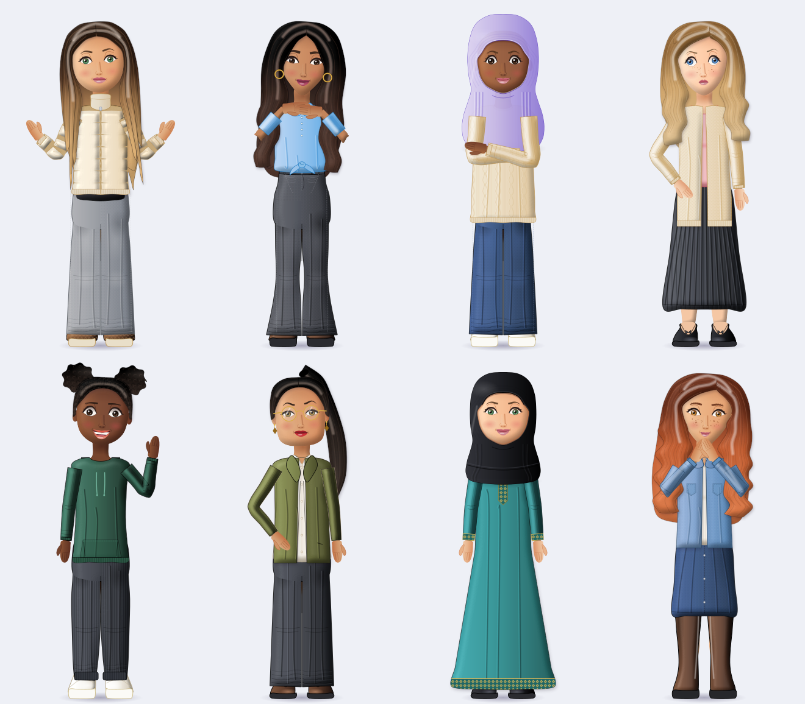
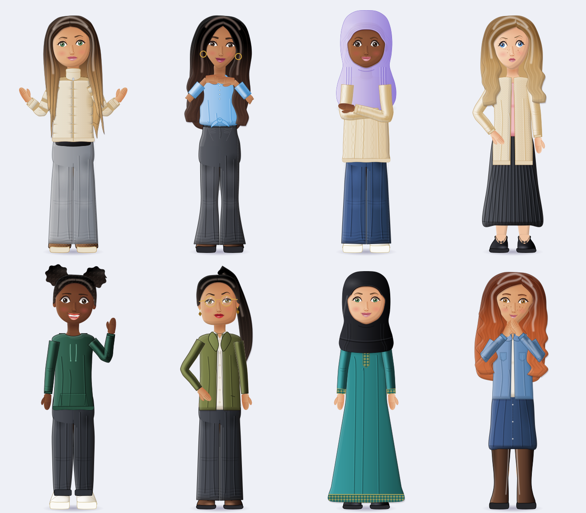

# Forge2D: women-first 2D avatar creator

A deterministic, layered **2D SVG** avatar system for HumanForge: full-body fashion avatars with a face, hair, head-covering
(hijab, turban, hats), clothing and accessory editor, for **React (web) and React Native**. It is **strictly 2D** (no 3D runtime, no
Blender, no GLB), runs fully offline, and needs **no paid service or API key**. All artwork is original and drawn in code (MIT licensed).

```bash
npm run demo:forge2d        # http://localhost:5173/forge2d.html          the web editor
                            #                       /forge2d-gallery.html  visual review gallery + statistics
npm run demo:forge2d-native # http://localhost:5173/forge2d-native.html   the React Native editor on react-native-web
npm run qa:forge2d [N]      # pixel checks on every asset + N random avatars, writes assets/forge2d/review.json
npm run sheet:forge2d       # renders the 8-character validation sheet + individual character files
npm test                    # includes scripts/forge2d-test.mts (67 checks)
```



The same eight characters in the portable render that React Native uses (no SVG filters at all):



Individual validation characters (config, SVG, 2x PNG): `assets/forge2d/validation/character-1..8.*`.

## Version 2: what was wrong and what changed

**Root cause of the first version's flat, paper-doll look** (traced through the renderer, not guessed):

1. *Proportions.* The skeleton was authored at about 5.8 heads tall with a long neck, a short 160 px torso, 370 px legs, narrow
   column trousers and tiny hands. The collage characters are about 4.6-5.4 heads tall with a large head, short neck, long torso,
   short legs and baggy trousers pooling on chunky shoes. Every garment, shoe and pose inherited the wrong body.
2. *Shading.* Everything was a flat fill with a left-to-right gradient and a few blurred ellipses. Nothing had volume.
3. *Sameness.* Garments were thin outlines of the same torso, and the default look (white tee, blue jeans) hid the lack of range.
4. *Thumbnails* cropped the same base avatar, so most tiles looked identical, and re-rendering about 50 inline SVGs on every edit was slow.

**What v2 does** (the engine, config schema, manifest, rules and editor are kept; the character was rebuilt):

| Area | Before | After |
| --- | --- | --- |
| Body | 400x784 canvas, 5.8 heads, legs compressed with a magic factor | named landmark table `LM` in `body.ts` (400x700, about 4.6 heads: head 140, torso 220, legs 244); every garment, shoe and accessory is authored against it |
| Shading | flat gradients | **lit volume**: each material group is an SVG `feDiffuseLighting` pass over a blurred alpha height map, lit from the upper left, with an ambient floor so shadows stay coloured (`Defs.lit` in `geom.ts`). No bitmaps |
| Hair | one flat ribbon per side | ombre roots, a back mass with feathered ends, an inner layer, three staggered pointed locks per side, strands, gloss and a glossy crown; one lighting pass per group |
| Clothing | outlined torso, thin sleeves | puffers are quilted cells lit in one pass (the gaps become grooves); sleeves bunch at the elbow and cuff; baggy trousers pool at the hem over chunky shoes; waistbands, whiskers and knee fades; a knotted shirt, vest, cropped long-sleeve added |
| Hands, feet | tiny mitten hands, small shoes | chunky hands (including a flat "under the chin" hand), 1.22x chunky footwear |
| Poses | 6 | 7 (added hands under chin) plus a small head lean per pose |
| Looks | white tee + blue jeans default | varied default; randomise draws from 14 curated coordinated looks |
| Thumbnails | wide crops of one avatar, inline SVG | per-category crops on a neutral base (no hair over garments, hair on a dark top, shoes on slim trousers), varied mid-tone colours for clothing, cached SVG images keyed by only the state they show |
| Preview speed | 1.1-1.8 s per edit in Chrome (about 45 lighting filters inline) | 15-170 ms: fewer filters (one pass per material group) and the preview is stacked per-layer images, so a layer whose markup did not change is not repainted |

**Image generation.** No image-generation tool is available here (no torch, diffusers, ollama or ComfyUI; the only cached model is
a speech model), and a paid or hosted API would break the "no mandatory paid service" rule and cannot be assumed to give separable,
aligned, consistent layers. So no AI image was used. The "dimensional rendered cartoon" feel is produced procedurally with SVG lighting.
The earlier 3D-render pack (`assets/cartoon-g3d`) was not reused: it needs a 3D toolchain and a stiff A-pose.

## Proportion guide (design estimates from observing the collage, not measurements)

Observed (hair top to chin = 1 head): total height about 4.6 (rows 1-2) to 5.4 (the shorts character); torso about 1.6-1.9 heads;
legs about 1.7-2 heads; thin short neck; narrow shoulders under bulky jackets; wide, slightly flared trousers pooling on the footwear;
chunky hands; heavy-lidded eyes with dark lash lines; thick brows; small lips with gloss; long straight ombre hair with pointed, layered ends.
Implemented as `LM` (`body.ts`): chin 176, shoulder 210, waist 318, hip 384, crotch 430, knee 538, ankle 634, ground 674 (+12 top padding).

## Use it

**React (web)**

```tsx
import { ForgeEditor } from 'humanforge/forge2d/ForgeEditor';
import { ForgeAvatar } from 'humanforge/forge2d/ForgeAvatar';
import { renderAvatarSvg, renderAvatarLayers, randomConfig, DEFAULT_CONFIG } from 'humanforge/forge2d';

<ForgeEditor defaultValue={saved} onSave={(config, svg) => api.save(config)} />
<ForgeAvatar config={saved} width={96} viewBox={[40, 8, 320, 420]} fast />
const svg = renderAvatarSvg(config, { width: 400 });          // one SVG string
```

**React Native** (iOS and Android; also works under react-native-web)

```bash
npx expo install react-native-svg        # or: npm i react-native-svg   (>= 13)
```

```tsx
import { ForgeEditorNative, ForgeAvatarNative } from 'humanforge/forge2d/native';
import { AvatarStore } from 'humanforge/forge2d';
import AsyncStorage from '@react-native-async-storage/async-storage';

<ForgeEditorNative
  store={new AvatarStore(AsyncStorage)}                 // persists saved looks; the default keeps them in memory
  onSave={(config, svg) => api.saveAvatar(config)} />   // `svg` is a portable SVG string of the avatar

<ForgeAvatarNative config={saved} width={96} framing="bust" />   // profile pictures, chat, lists
```

The configuration is plain JSON, so the same avatar works on both platforms. `renderAvatarSvg(config, { portable: true })` returns
the exact SVG the native components draw, if you want to render it some other way.

**Phone performance.** In `ForgeEditorNative` only the big preview is live SVG (drawn with `fast` while taps arrive, upgraded to
full quality after 450 ms idle). Option chips are baked WebP files in `src/forge2d/native/thumbs/` (neutral base, so they don't follow
your skin or hair colour), which means changing eyes never redraws a chip. After adding or changing an option run
`npm run build:thumbs-forge2d` and commit the regenerated files. `ForgeAvatarNative` takes `fast` (default: on for crops under 300 units tall).

**Why a separate "portable" renderer.** The web look uses SVG lighting filters (`feDiffuseLighting`). I checked the installed
`react-native-svg` 15.16 source: its JS declares those elements, but its native iOS and Android code implements only Blend,
ColorMatrix, Composite, Flood, GaussianBlur, Merge and Offset. So on native the same volume is built **without any filter**: stepped inner
bevels (dark along the lower-right inside edge, light along the upper-left, clipped to each shape), radial-gradient glows and
stacked strokes. Silhouettes are identical to the web render (QA requires a match within 3%); the shading is slightly cruder.
The portable output only uses elements and attributes that `react-native-svg` supports (a test checks it against the package's own tag
table), a full avatar is about 180 KB of SVG, and thumbnails drop layers outside their crop and fine detail (about 75 KB each).

**What is and is not verified for React Native.** Verified: the components typecheck against the real `react-native-svg` types; the
editor runs on `react-native-web` with `react-native-svg`'s web build (tabs, options, hijab, randomise, save, restore, no errors); the
portable SVG passes the element / attribute audit and the QA silhouette and body checks. **Not verified: any real iPhone or Android device**
(native parsing of `<use>` / `<mask>`, frame times, memory). Parsing about 100 KB of SVG per thumbnail is the likely cost on a phone:
if a tab feels slow, cut the number of tiles per screen, lower thumbnail detail, or pre-render PNG layers server-side with
`renderAvatarLayers` and show them with `<Image>`. For long lists of avatars, snapshot one `ForgeAvatarNative` to a bitmap
(for example with `react-native-view-shot`) and show the bitmap.

`ForgeAvatar` / `ForgeEditor` (DOM) are web only; `ForgeAvatarNative` / `ForgeEditorNative` are the React Native versions.

## How it is built

| Piece | File |
| --- | --- |
| Spline and colour helpers, `Defs` (gradients, clips, masks, **lit** lighting filter) | `src/forge2d/geom.ts` |
| Face shapes, expression table, eyes, brows, nose, lips | `face.ts` |
| Landmarks, 7 arm poses with head lean, lit skin figure, hands | `body.ts` |
| Hair: lock/strand generator + custom silhouettes | `hair.ts`, `hair2.ts`, `hairs.ts` |
| Hijabs, turbans, hats (built from the live face outline) | `headwear.ts` |
| Tops and outerwear; dresses (same builder, long hems) | `tops.ts`, `dresses.ts` |
| Bottoms, shoes, accessories | `bottoms.ts`, `shoes.ts`, `accessories.ts` |
| Config schema, defaults, validation + fallback | `types.ts`, `defaults.ts`, `validate.ts` |
| Compatibility rules | `compat.ts` |
| Asset manifest, plug-in assets | `manifest.ts`, `external.ts` |
| Composition engine (per-group Defs, per-layer SVG) | `render.ts`, `layers.ts` |
| Randomise (with curated looks), save / restore, statistics | `random.ts`, `storage.ts`, `stats.ts` |
| Editor (layer-cached preview, cached thumbnails, export PNG/SVG) and `<ForgeAvatar>` | `ForgeEditor.tsx`, `ForgeAvatar.tsx` |
| React Native editor and `<ForgeAvatarNative>` | `native/ForgeEditorNative.tsx`, `native/ForgeAvatarNative.tsx` |
| Shared editor logic (crops, neutral bases, thumbnail colours, tabs and sections) | `editorModel.ts` |

**Layer order** (`layers.ts`): ground shadow, back hair, headwear back, legs, torso/neck, shoes, dress, bottoms, top, outer,
body accessories (scarf, necklace), bag, arms (mid), ears, face, features, front hair, headwear front, head accessories, arms (front).
Poses that cross the body (crossed, hands over mouth, hands under chin) draw the arms in the front layer. Sleeves are generated from the
same arm skeleton as the skin, so they never drift from the arms. **Head layers** lean a few degrees about the neck per pose
(not under a hijab, whose drape belongs to the shoulders).

**Head coverings.** A hijab is a cloth silhouette with a face-shaped cut-out (an SVG mask built from the face outline of the
selected shape), so it hugs every face shape without gaps. Full coverings (hijabs, turbans, head wrap) remove the hair layers
entirely, so hair cannot show through. 8 hijab wraps x 4 fabrics (jersey, chiffon, satin, cotton) x colour x optional undercap.

## Configuration (versioned JSON, unchanged by v2 except the new `chin` pose)

```jsonc
{ "schema": "humanforge.avatar2d", "version": 1, "style": "forge-2d-v2",
  "face": { "shape": "oval", "skin": "golden", "eyes": "almond", "eyeColor": "#7a4a26", "brows": "soft", "nose": "soft",
            "mouth": "balanced", "lipColor": "#c8727d", "cheeks": 2, "freckles": 0, "mole": "none", "eyeshadow": "#00000000", "lashes": true },
  "hair": { "style": "long-center", "color": "#8a5a34", "highlight": "#d9ae72", "highlightStyle": "balayage" },
  "headwear": { "style": "none", "color": "#9db69b", "fabric": "jersey", "undercap": false },
  "outfit": { "top": "long-sleeve", "topColor": "#2a2b30", "bottom": "wide-jeans", "bottomColor": "#9a9da3", "dress": "none", "dressColor": "#2f5b4a",
              "outer": "puffer-crop", "outerColor": "#e6dcc8", "shoes": "fluffy-boots", "shoesColor": "#7a5236" },
  "accessories": { "glasses": "none", "earrings": "none", "necklace": "none", "bag": "none", "scarf": "none", "hairAccessory": "none", "...": "colours" },
  "expression": "neutral", "pose": "relaxed" }
```

Configurations saved by v1 still load (the `style` string is informational; every field is validated and repaired). `normalizeConfig` fills
missing fields, replaces invalid values and **missing assets** with the default and reports every fix; `renderAvatarSvg` always draws
something and calls `onWarn` with the reason. Saved looks (`AvatarStore`) are normalised on restore.

## Manifest and rules

`buildManifest()` returns one `AssetEntry` per option (187 today: 6 face shapes, 12 skin tones, 8 eyes, 6 brows, 6 noses, 6 lips, 25 hairstyles,
15 head coverings, 18 tops, 9 jackets, 16 bottoms, 10 dresses, 9 shoes, 27 accessories, 7 expressions, 7 poses): id, category, name, kind
(`procedural-svg` or plug-in `svg-fragment`), path, size, layers with order, anchors, variants (palette, fabrics, textures), compatibility
tags, **status** (`draft` / `tested` / `approved`, from `assets/forge2d/review.json`), and source + licence.

`compat.ts` has two kinds of rules. **error**: the look would be wrong, so the editor disables the option, randomise never
produces it and the renderer repairs it (hats vs updos and wide styles, headband under a hat). **hidden**: allowed, but covered
(hijab hides hair, earrings, hair accessories, scarf and necklace; a dress replaces top and bottom; high necklines hide necklaces).
The editor explains hidden items in a note on the preview.

## Combination statistics (computed from the real manifest and rules, `computeStats`)

| | |
| --- | --- |
| Theoretical (every option independent, shapes only) | 1.70e19 |
| Permitted (no error rule violated) | 1.47e19 |
| Visually distinct (hidden elements collapsed) | 1.76e17 |
| Visually distinct with every colour choice | 8.16e32 (an upper bound, not a promise each one looks good) |
| Combinations actually tested (automated, `npm run qa:forge2d 300`) | 538 |
| Combinations approved for release | 0 (needs human sign-off) |

## Quality assurance: what is and is not verified

Automated (`scripts/forge2d-test.mts`, `tools/forge2d/qa.mts`): schema, fallback and restore; rules and repairs; manifest integrity;
every option renders alone without warnings or `NaN`; determinism; layer order; and, on rasterised renders of every asset plus random
avatars: full body visible with both feet on the ground line, nothing touching the canvas edge, no enclosed transparent gaps in the
forehead/hair area (down to the chin under head coverings; hoop-earring interiors are excluded), and **no hair or hair accessory showing
through any hijab, turban or head wrap** (a render with and without hair must be pixel-identical). QA found and fixed a real fit defect
(the twisted turban's lower corners left a gap above the ears). SVG generation takes about 3 ms per avatar.

Verified in Chrome (the Browser pane): the editor renders, options and colours change the avatar, randomise / reset / save / restore
round-trip through `localStorage`, an incompatible hat is disabled with the reason on hover, and the phone layout works. Edits settle in
15-170 ms in that browser (software rendering, so a GPU browser should be at least as fast).

Not verified by tools: artistic quality (use the gallery and the validation sheet), real-device performance on low-end phones,
real React Native devices (see above), export on every browser, and combinations beyond the sampled ones. Pixel checks run on librsvg
rasters in the blur-free `fast` mode, for both the web and the portable render.

## Visual assessment against the target collage

Checked against the ten acceptance questions by inspecting the rendered sheet, zoomed faces, an expression strip and a pose strip:

1. *Adult fashion avatar, not childlike?* Mostly: adult faces and a 4.6-head fashion build, but the big heads and chunky bodies still read as stylised avatars.
2. *Expressive, dimensionally shaded face?* Yes at zoom: lit skin, glossy irises with catchlights, lash lines, glossy lips, blush. Faces share one template and are still more generic than the reference.
3. *Volumetric, layered hair?* Yes for the long and wavy styles. The pixie, the high ponytail and the curly ends are weaker.
4. *Balanced proportions?* Yes (see the guide above).
5. *Convincing garment volume and distinct silhouettes?* Puffers, knits, blazers, dresses, hijabs: yes. Plain trousers are still simple columns with pooled hems.
6. *Not identical bodies in recoloured shirts?* The outfits, hair, poses and head coverings differ clearly, but there is **one body build**; body-shape variants are not implemented.
7. *Poses and expressions visibly differ?* Yes (7 expressions, 7 poses; the subtle ones are neutral / confident / thoughtful).
8. *Consistent across characters?* Yes.
9. *Complete character visible?* Yes, checked automatically for every asset and 300+ random avatars.
10. *No longer the flat-vector result?* Yes, it is clearly dimensional, but it is still a clean vector look, not the glossy soft-rendered finish of the reference.

No similarity score was measured and none is claimed.

Other known gaps: front view only (no head turns, no leg poses); the "hands under chin" pose puts the hands at the neckline rather
than tucked under the chin; thumbnails use the blur-free `fast` mode (lighting kept, soft shadows dropped); not every hair x face-shape
combination was inspected by eye.

## Adding assets

**Procedural (preferred).** Add an entry to the relevant table: `TOPS` / `OUTER` in `tops.ts` (neckline, sleeve, fit, hem from `HEM`, texture, `puff`...),
`DRESSES`, `BOTTOMS` (leg profile by y), `SHOES`, `HEADWEAR` (hijab silhouettes are point lists in `HIJABS`), `EYE_STYLES`, `BROW_STYLES` ... or a hairstyle
in `hair.ts` (family table `FAM`) / `hair2.ts`. Author against the `LM` landmarks and use `d.lit({...})` for volume. The manifest, editor, validation,
randomiser and statistics pick it up automatically. Then run `npm test`, `npm run qa:forge2d`, open `/forge2d-gallery.html` and look at it.

**Authored SVG fragments (no code changes).**

```ts
import { registerAsset } from 'humanforge/forge2d';
registerAsset({
  id: 'star-clip', category: 'hairAccessory', name: 'Star clip',
  layers: { 'accessory.head': '<path d="M240,70l4,9 10,1-8,7 3,10-9-5-9 5 3-10-8-7 10-1z" fill="{{color}}"/>' }, // 400x700 canvas
  source: { author: 'you', license: 'CC0-1.0' },
});
```
Supported categories: hair, headwear, top, outer, bottom, dress, shoes, glasses, earrings, necklace, scarf, bag, hairAccessory.
Fragments use the shared canvas and anchors; `{{color}}` is replaced by the colour picked for that slot.

**Approval.** `qa.mts` marks assets `tested`. Only a person adds ids to `approved` in `assets/forge2d/review.json`, after
looking at the artwork. Nothing is `approved` today.
